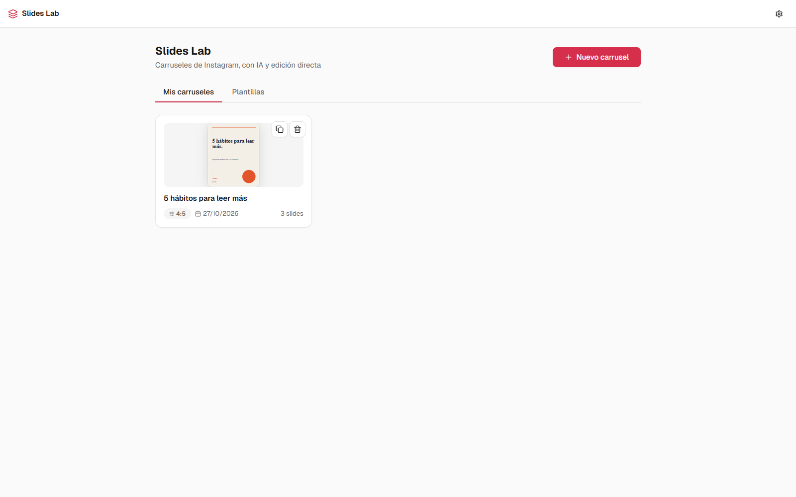
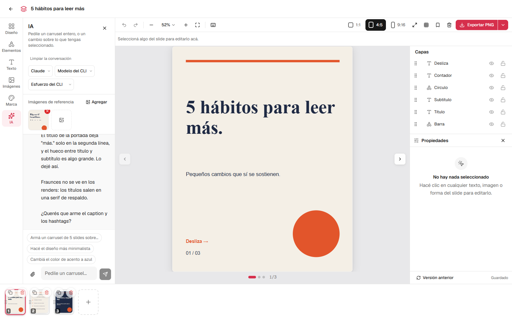
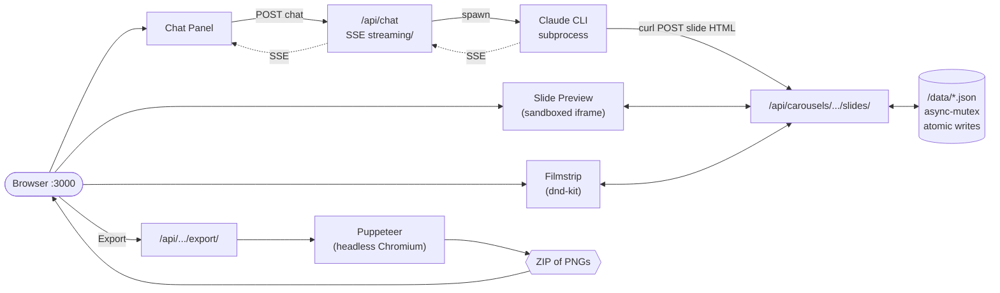

<div align="center">

# Slides Lab

### Chat with Claude. Design Instagram carousels. Export pixel-perfect PNGs.

**Local-first. Open source. One command to start.**

[](./LICENSE)
[](https://claude.ai)
[](https://nextjs.org)
[](https://react.dev)
[](https://www.typescriptlang.org)
[](https://tailwindcss.com)


</div>

---

## Table of contents

- [Why Slides Lab](#-why-slides-lab)
- [See it in action](#-see-it-in-action)
- [Quickstart (60 seconds)](#-quickstart-60-seconds)
- [What you can do](#-what-you-can-do)
- [How the AI agent works](#-how-the-ai-agent-works)
- [Privacy: what leaves your machine](#-privacy-what-leaves-your-machine)
- [Costs](#-costs)
- [Slash commands](#-slash-commands)
- [Architecture](#-architecture)
- [Tech stack](#-tech-stack)
- [Project structure](#-project-structure)
- [Documentation](#-documentation)
- [Configuration](#%EF%B8%8F-configuration)
- [Troubleshooting](#-troubleshooting)
- [Roadmap](#%EF%B8%8F-roadmap)
- [Acknowledgments](#-acknowledgments)
- [License](#-license)

---

## ✨ Why Slides Lab

Designing Instagram carousels eats hours. You either:

- Pay $20–60/month for a closed-source tool that limits how creative you can get
- Wrestle Canva templates that everyone else also uses
- Hand-craft slides in Figma and lose your weekend

**Slides Lab takes a different bet.** You chat with Claude — the same model many designers already trust — and it generates real HTML/CSS slides that get screenshotted to PNGs at exact Instagram dimensions. Slides are unique, on-brand, and pixel-perfect. The app, your carousels and your uploads stay on your laptop; what the AI agent sees goes to its provider — see [Privacy](#-privacy-what-leaves-your-machine).

It's open source under MIT. Fork it, tweak the system prompt, ship your own variant. No accounts. No subscriptions. No vendor lock-in.

---

## 🎬 See it in action

**Dashboard** — your carousels, templates, and one-click export.



**Editor** — chat panel (left), live preview (center), drag-reorderable filmstrip (bottom).



> The slides shown above were generated by chatting with Claude. No templates, no copy-paste — every layout, color, and font choice came from a conversation.

---

## 🚀 Quickstart (60 seconds)

> First run takes 1–2 minutes (Puppeteer downloads ~300 MB of Chromium for PNG export). After that, every launch is seconds.

### One-command path (recommended)

1. **Install [Claude Code](https://docs.anthropic.com/en/docs/claude-code)** and authenticate.
2. **Clone and open the repo** in Claude Code:
   ```bash
   git clone https://github.com/maurild14/slides-lab.git
   cd slides-lab
   claude
   ```
3. In the Claude Code prompt, type:
   ```
   /start
   ```

That's it. Dependencies install, the dev server starts, your browser opens. Now design carousels by chatting.

### Manual path (if you don't use Claude Code)

```bash
git clone https://github.com/maurild14/slides-lab.git
cd slides-lab
npm run setup        # installs deps + seeds /data/
npm run dev          # starts http://127.0.0.1:3000
```

Requires **Node ≥ 22.18** (`.nvmrc` pins 22). The server listens on `127.0.0.1` only and has no auth — don't expose it to a network ([SECURITY.md](./SECURITY.md)).

The AI chat needs at least one agent CLI installed — [Claude Code](https://docs.anthropic.com/en/docs/claude-code) or [Codex](https://developers.openai.com/codex/cli). Without either, the editor and export still work for static slides.

---

## 🧰 What you can do

- **Three-panel editor** designed for flow: chat (left), live preview (center), drag-reorderable slide filmstrip (bottom).
- **Generate slides by chatting**: "Make me a 5-slide carousel about productivity habits — bold sans-serif, dark mode, accent red." Watch them stream in.
- **Iterate per slide**: "Make slide 3 more minimal", "Change the accent to teal", "Swap the hook for something punchier."
- **Three Instagram aspect ratios** ready to go: 1:1 (1080×1080), 4:5 (1080×1350), 9:16 (1080×1920).
- **AI image generation, built in** — with Codex as the engine, the agent generates illustrations, textures and hand-drawn elements on its own when a slide calls for one, billed to your ChatGPT plan. No API key, no third-party service. What counts as "calls for one" lives in [`docs/imagegen-policy.md`](./docs/imagegen-policy.md) — plain markdown you can edit, no code, no restart.
- **Canvas editing** — prompt an image from the right-hand panel, then drag it onto the slide. Alignment guides snap it to centers, safe margins and neighbouring elements; resize from any corner; nudge with arrow keys.
- **Brand config** — name, color palette, fonts, logo, style keywords. The agent reads it before every generation so output stays on-brand.
- **Templates** — save any carousel as a template, reuse it for the next one.
- **Reference images** — drop in screenshots of carousels you love. The agent studies them to match style.
- **Drag to reorder** slides via dnd-kit. Undo per-slide if a tweak goes sideways (version history per slide).
- **Safe-zone overlay** to verify nothing important crops behind Instagram's UI.
- **Fullscreen preview** for the final review.
- **One-click export** — Puppeteer screenshots each slide HTML at the exact pixel dimensions Instagram expects, zips them, downloads.
- **Captions + hashtags** generator built into the editor.
- **Local storage** — slides, brand, uploads, exports all live in `/data/` and `/public/uploads/`. No database, no account. What does leave the machine is listed under [Privacy](#-privacy-what-leaves-your-machine).

---

## 💬 How the AI agent works

The in-app agent is an **agent CLI spawned as a subprocess** from `/api/chat`. Messages stream back to the browser via Server-Sent Events. Two engines are supported, and you switch between them from the dropdown at the top of the chat panel:

| Engine | Runs as | Image generation |
|---|---|---|
| **Claude** | `claude -p` with a curl-only shell, `WebFetch`, `Read` limited to `public/uploads` and a private temp dir, `Write` limited to that temp dir | via `POST /api/images/generate` |
| **Codex** | `codex exec --json` in the `workspace-write` sandbox (writes to the project and the OS temp dir, network on) | built-in `image_gen` tool |

Claude gets no free shell: `Bash(curl *)` is its only command rule, and anything outside the allowlist is denied because `-p` has no one to ask. The details, and the holes that remain, are in [docs/agent-engines.md](./docs/agent-engines.md) and [SECURITY.md](./SECURITY.md).

Each engine keeps its own conversation, so switching mid-carousel starts a fresh thread rather than confusing the other one.

When you ask for a slide, the agent:

1. Reads your brand config + active carousel state from the system prompt
2. Writes the slide as a complete HTML/CSS string
3. POSTs it to `/api/carousels/[id]/slides` with `curl`
4. Renders it, reads the PNG and the layout warnings, and fixes what it sees ([docs/audit.md](./docs/audit.md))
5. The new slide appears in your filmstrip seconds later

### Example chat

```
You    > Create a 5-slide carousel about “3 morning habits that
         actually move the needle.” Punchy, dark mode, accent red,
         portrait 4:5.

Claude > Coming up. I'll build a hook slide, three habit slides,
         and a CTA. Working...
         [streams 5 HTML slides into the filmstrip]

You    > Slide 3 — the headline is too long. Cut it in half and
         move the icon to the top.

Claude > Done.
         [updates that slide; you can /undo if you preferred the old one]
```

### How the slides become PNGs

Slides are stored as **body-level HTML** (no `<html>`/`<head>`/`<!DOCTYPE>`). The shared function `wrapSlideHtml()` in [`src/lib/slide-html.ts`](./src/lib/slide-html.ts) wraps that body into a full document — adding font loading, dimension constraints, and box-sizing reset — and serves it both:

- to a **sandboxed `<iframe>`** for live preview in the editor
- to **Puppeteer (headless Chromium)** for export, screenshot at exact Instagram pixel dimensions, zipped, downloaded

Because the same wrap function feeds both paths, what you see is exactly what you export. No surprises.

---

## 🔒 Privacy: what leaves your machine

Slides Lab has no server of its own and no telemetry. Your carousels, brand and uploads are files on your disk, and the app listens on `127.0.0.1` only. But it is not offline:

- **The agent's provider sees your content.** Every chat turn sends your message and the system prompt — your brand config and the full HTML of every slide in the carousel — to Anthropic (Claude) or OpenAI (Codex). So does every image the agent reads: attachments, reference images, and the renders of your slides. That traffic runs under your own account and that provider's terms.
- **Google Fonts sees font requests.** Slides load their fonts from `fonts.googleapis.com` / `fonts.gstatic.com`, in the editor and during export.
- **The agent can browse.** Claude has `WebFetch` and Codex runs with network access, so when it researches a topic it fetches pages from the open web. Those sites see the requests, and what they return lands in the agent's context.
- **Next.js telemetry.** `next dev` / `next build` send Next.js's anonymous usage telemetry unless you set `NEXT_TELEMETRY_DISABLED=1`.

---

## 💸 Costs

Slides Lab is free; the agent is not. **Every chat turn is billed to the plan or account the CLI is logged into** — your Claude subscription or API key, or your ChatGPT plan for Codex (image generation included). A full carousel built from scratch runs around 250k tokens.

Claude stops a single turn once its estimated cost reaches `CHAT_MAX_BUDGET_USD` (**5 USD** by default; set it in `.env.local`). Codex has no per-turn cap. The chat panel shows how much of the plan's current window you have used and how many tokens the conversation has spent.

---

## 🛠 Slash commands

Type these inside Claude Code:

| Command         | What it does                                                                                            |
|-----------------|---------------------------------------------------------------------------------------------------------|
| `/start [port]` | Install + seed + run + open browser. Idempotent — re-running on a healthy install is seconds.           |
| `/stop [port]`  | Kill the dev server. Defaults to `:3000`, accepts a port arg matching `/start`.                         |
| `/reset`        | Wipe local carousels, templates, brand config, uploads, exports — and re-seed defaults. Asks first.    |
| `/doctor`       | Run setup diagnostics: Node version, Claude CLI on PATH, deps installed, data files seeded, port free. |

You can also run them outside Claude Code:

```bash
npm run setup     # equivalent to /start (skips the browser-open + background server bits)
npm run dev       # start the dev server
npm run build     # production build
npm run doctor    # run scripts/doctor.mjs (works pre-`npm install`)
```

---

## 🏗 Architecture



**Why these choices:**

- **Local-first, single-user.** The whole app is a web app bound to `127.0.0.1` talking to local files. No auth, no database. A proxy rejects requests whose `Host` or `Origin` isn't this machine, so other sites can't drive it from your browser.
- **An agent CLI as the agent.** Lets us reuse whatever the user already pays for — no API keys of our own, no cloud account. The subprocess gets `curl` (to call the slide-write endpoints), web access (for research while designing), and file access scoped to uploads and its own temp dir.
- **Images from the agent's own subscription.** Codex ships `image_gen` (gpt-image-2) built in and bills it to the user's ChatGPT plan, so image generation needs no third-party service and no `OPENAI_API_KEY`.
- **Slides as HTML.** Claude already writes great HTML/CSS — way more flexible than canvas, way easier to debug than a JSON DSL. The same HTML powers preview *and* export, so what you see is what you ship.
- **Sandboxed iframes.** Slide iframes never get `allow-scripts`, so slides can't run code. Export renders them in Puppeteer with JavaScript off and the network limited to Google Fonts.
- **JSON file storage with async-mutex + atomic writes.** No SQLite, no Postgres. Reads and writes go through [`src/lib/data.ts`](./src/lib/data.ts) with proper locking, and writes are tmp-file + rename to avoid torn JSON.

For more, see [`docs/architecture.md`](./docs/architecture.md).

---

## 📦 Tech stack

| Layer        | Tool                                                                              |
|--------------|-----------------------------------------------------------------------------------|
| Framework    | [Next.js 16](https://nextjs.org) (Turbopack), [React 19](https://react.dev)       |
| Language     | TypeScript 5                                                                      |
| Styling      | [Tailwind CSS v4](https://tailwindcss.com) (CSS-first config in `globals.css`)    |
| UI primitives| [Radix UI](https://www.radix-ui.com), [lucide-react](https://lucide.dev)          |
| Drag/drop    | [@dnd-kit](https://dndkit.com)                                                    |
| AI agent     | [Claude CLI](https://docs.anthropic.com/en/docs/claude-code) or [Codex CLI](https://developers.openai.com/codex/cli) subprocess |
| Image gen    | Codex built-in `image_gen` (gpt-image-2), no API key                              |
| Image export | [Puppeteer](https://pptr.dev), [Sharp](https://sharp.pixelplumbing.com)           |
| Zipping      | [Archiver](https://github.com/archiverjs/node-archiver)                           |
| Storage      | JSON files + [async-mutex](https://github.com/DirtyHairy/async-mutex)             |
| Animation    | CSS-first ([Emil Kowalski's design philosophy](https://animations.dev))           |

---

## 📁 Project structure

```
slides-lab/
├── .claude/
│   └── commands/             ← /start, /stop, /reset, /doctor (Claude Code slash commands)
├── data/                     ← user state (gitignored): brand, carousels, templates, exports
├── docs/                     ← one page per topic (see Documentation below)
│   └── screenshots/          ← README assets
├── public/uploads/           ← user uploads (gitignored): logos, reference images
├── scripts/
│   ├── setup.mjs             ← npm install + seed data dirs + engine detection (cross-platform)
│   ├── doctor.mjs            ← env diagnostic (zero deps, runs pre-install)
│   └── check-*.ts            ← self-checks (plain node + assert)
├── src/
│   ├── app/
│   │   ├── api/              ← every backend route (chat, carousels, slides, export, brand, ...)
│   │   ├── carousel/[id]/    ← editor page
│   │   ├── globals.css       ← Tailwind v4 theme + Emil-style motion tokens
│   │   ├── layout.tsx
│   │   └── page.tsx          ← dashboard page
│   ├── components/
│   │   ├── brand/            ← BrandSetup, ColorPicker, FontSelector, LogoUpload
│   │   ├── chat/             ← ChatPanel, ChatMessage, ChatInput, ReferenceImages
│   │   ├── editor/           ← CarouselPreview, SlideFilmstrip, SlideRenderer, ExportButton, ...
│   │   ├── layout/           ← TopBar
│   │   ├── templates/        ← TemplateGallery, TemplateCard
│   │   └── ui/               ← Button, Input, Badge, ConfirmDialog, CreateCarouselDialog
│   ├── lib/
│   │   ├── chat-system-prompt.ts   ← dynamic system prompt (brand + carousel context)
│   │   ├── slide-html.ts            ← wrapSlideHtml() — the rendering contract
│   │   ├── carousels.ts             ← carousel + slide CRUD with version history
│   │   ├── data.ts                  ← JSON storage with async-mutex + atomic writes
│   │   ├── agents.ts                ← engine registry: discovery, args, stream parsing
│   │   ├── canvas-utils.ts          ← slide/screen coordinate math + snapping
│   │   └── ...
│   └── types/                ← shared TypeScript types
├── .github/                  ← CI, Dependabot, issue + PR templates
├── AGENTS.md                 ← the contract every AI agent reads: commands, rules, docs map
├── CLAUDE.md                 ← Claude Code specifics; imports AGENTS.md
├── CONTRIBUTING.md           ← checks, conventions, language
├── SECURITY.md               ← reporting + threat model
├── CHANGELOG.md
├── CODE_OF_CONDUCT.md
├── LICENSE                   ← MIT
├── README.md                 ← you are here
├── next.config.ts
├── package.json
└── tsconfig.json
```

---

## 📚 Documentation

This README is the tour. The working documentation lives in [`docs/`](./docs/),
one page per topic, and is written for whoever — or whatever — is about to change
the code:

| Page | Covers |
| --- | --- |
| [architecture](./docs/architecture.md) | Processes, data flow, module map |
| [api](./docs/api.md) | Every HTTP route |
| [data-model](./docs/data-model.md) | Types, JSON storage, locking, version history |
| [agent-engines](./docs/agent-engines.md) | The CLI subprocess, the system prompt, usage metering |
| [slide-html](./docs/slide-html.md) | What a slide stores and how it is rendered |
| [canvas](./docs/canvas.md) | The editor: selection, gestures, layers, undo, autosave |
| [audit](./docs/audit.md) | How the agent sees what it wrote |
| [export](./docs/export.md) | PNG / JPG / PDF / ZIP and Puppeteer |
| [ui](./docs/ui.md) | Tokens, copy, errors, accessibility |
| [imagegen-policy](./docs/imagegen-policy.md) | When the agent generates an image (injected into the prompt) |
| [workflows](./docs/workflows.md) | Setup, dev loop, verification, troubleshooting |
| [decisions](./docs/decisions.md) | What was deliberately left simple, and when to add it |

[`AGENTS.md`](./AGENTS.md) is the entry point for AI coding agents: the commands,
the rules that cost a real bug, and the map into `docs/`.
[`CLAUDE.md`](./CLAUDE.md) imports it and adds only what is Claude Code specific.

---

## ⚙️ Configuration

### Environment variables (`.env.local`)

Created by `scripts/setup.mjs`, which looks for both engines. Everything is optional; [`.env.example`](./.env.example) lists it:

```bash
CLAUDE_CLI_PATH=/path/to/claude   # set if `which claude` doesn't find it
CODEX_CLI_PATH=/path/to/codex     # set if `which codex` doesn't find it
CHAT_MAX_BUDGET_USD=5.00          # Claude's per-turn spend cap
```

On Windows, run `where claude` in PowerShell to find the path (the native installer puts it at `C:\Users\<you>\.local\bin\claude.exe`, an npm install at `...\AppData\Roaming\npm\claude.cmd`), then set `CLAUDE_CLI_PATH` in `.env.local`.

### Brand config

Set on first run (or via the gear icon in the top bar). Stored at `/data/brand.json`. Fields:

- **Name** — your handle / company / project
- **Colors** — primary, secondary, accent, background, surface
- **Fonts** — heading + body (Google Fonts; the `/api/fonts` endpoint serves a curated list)
- **Logo** — optional; used by Claude when you ask for branded slides
- **Style keywords** — free-text style hints ("editorial, minimalist, warm tones") that get injected into Claude's system prompt

### Templates

Save any carousel as a template via the bookmark icon in the editor toolbar. Templates appear in the dashboard's Templates tab. Stored at `/data/templates.json`.

### Reference images

Drop screenshots into the chat panel's "Reference Images" section. Stored under `/public/uploads/`; the agent opens them with its `Read` tool, which is scoped to that folder and its own temp dir.

---

## 🩺 Troubleshooting

**`/start` says "Node v20 detected, need ≥22.18."**
The `check:*` scripts run `.ts` files straight through Node, which needs 22.18+, and Puppeteer 25 needs 22. Install via [nodejs.org](https://nodejs.org) or [nvm](https://github.com/nvm-sh/nvm).

**`/start` says "Claude CLI not found."**
Install [Claude Code](https://docs.anthropic.com/en/docs/claude-code) and authenticate. The app checks `$CLAUDE_CLI_PATH` first, then `~/.local/bin/claude` (`claude.exe` on Windows), `/usr/local/bin/claude`, `/opt/homebrew/bin/claude`, `~/.npm-global/bin/claude`, `%APPDATA%\npm`, and finally your `PATH`. If yours lives elsewhere, set `CLAUDE_CLI_PATH` in `.env.local`.

**Port 3000 is in use.**
Run `/stop` to kill whatever's there, or run `/start 3001` to use a different port.

**The page or the API answers `403 Host not allowed` / `Origin not allowed`.**
You opened it through something other than `localhost:<port>` or `127.0.0.1:<port>` — a LAN IP, a custom hostname, a tunnel. That is the DNS-rebinding guard in `src/proxy.ts`, on purpose: the app has no auth.

**The chat stops with a budget error.**
The turn hit `CHAT_MAX_BUDGET_USD`. Raise it in `.env.local` and restart the dev server, or ask for less per turn.

**The agent says it can't read a file or run a command.**
Expected for anything outside its allowlist: `curl`, `WebFetch`, `Read` in `public/uploads` and its private temp dir. If it fails on its own slide renders, file an issue with the chat transcript.

**The chat stream dies mid-build.**
Something wrote a file inside the project, Fast Refresh reloaded, and the reload killed the stream. [docs/workflows.md](./docs/workflows.md#troubleshooting) covers this and the other engine-level symptoms.

**Export fails or hangs.**
Likely a Puppeteer/Chromium issue. Try `rm -rf node_modules .next && npm install` to re-trigger the Chromium download. On Linux you may need `apt install` of common Chromium dependencies (libnss3, libatk1.0-0, libxss1, etc.).

**Slides look fine in preview but export looks different.**
That shouldn't happen — both go through `wrapSlideHtml()`. If it does, file an issue with the slide HTML attached.

**The AI keeps generating slides that ignore my brand colors.**
Open the brand setup (gear icon) and confirm your colors and style keywords are saved. They're injected into Claude's system prompt on every chat request via `chat-system-prompt.ts`.

**Run `/doctor`** for a full env audit — it'll tell you which of the above applies.

---

## 🗺️ Roadmap

Open ideas — PRs welcome, see [CONTRIBUTING.md](./CONTRIBUTING.md). Tick what you ship, add your own.

- [ ] **Multi-language slide generation** — Spanish-LATAM voice presets so creators don't fight the AI's English defaults
- [ ] **Reels storyboard mode** — vertical 9:16 with optional text-on-clip annotations
- [ ] **Twitter/X thread export** — same brand voice, different surface
- [ ] **Notion / Linear export** — push the carousel as a doc with each slide as a section
- [ ] **Theme presets gallery** — community-curated `style-presets.json` you can one-click apply
- [ ] **Per-slide AI chat** — a smaller chat thread scoped to a single slide
- [ ] **Hosted demo** — for people who want to try before installing Claude Code

---

## 🙏 Acknowledgments

- **[Open Carrusel](https://github.com/Hainrixz/open-carrusel)** — Slides Lab started as a fork of Open Carrusel (MIT). Its copyright notice stays in [LICENSE](./LICENSE).
- **[Emil Kowalski](https://emilkowal.ski)** — animation philosophy that shaped the whole motion system. The `oc-*` CSS classes encode his design-engineering principles (custom easings, restraint over excess, `@starting-style` over JS for entries).
- **[Anthropic](https://www.anthropic.com)** — Claude (the model) and Claude Code (the CLI) are the brain of the in-app agent.
- **[Vercel](https://vercel.com)** — Next.js + Turbopack make local-first React apps feel snappy.
- **[Radix UI](https://www.radix-ui.com)** + **[shadcn/ui](https://ui.shadcn.com)** — the patterns underneath the dialog/button/input primitives.
- **[dnd-kit](https://dndkit.com)** — the only sane drag-and-drop story in React.
- **[Puppeteer](https://pptr.dev)** + **[Sharp](https://sharp.pixelplumbing.com)** — the export pipeline.

---

## 📄 License

[MIT](./LICENSE). Copies and substantial portions must keep the copyright and permission notice.

---

<div align="center">

**Built with Claude Code.**

*Hecho para creadores que construyen el futuro.*

</div>
