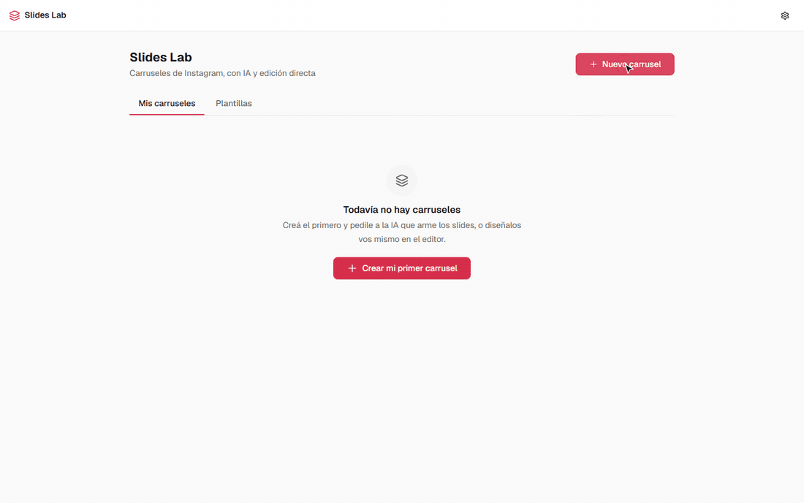
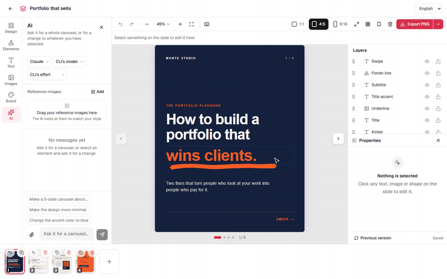
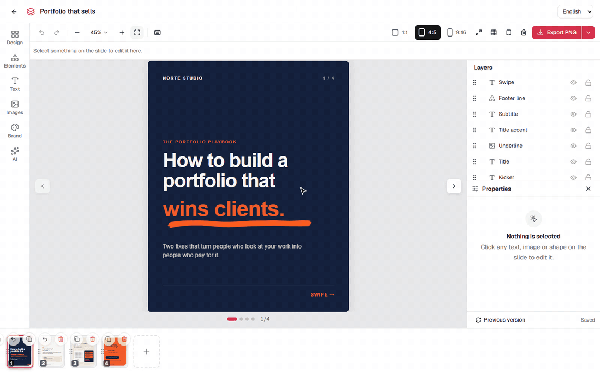
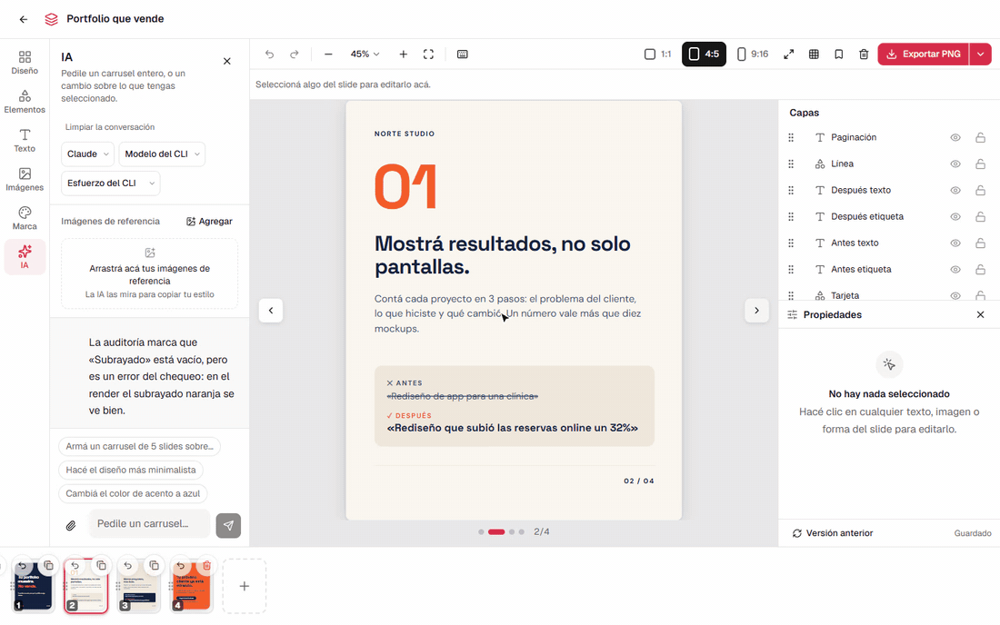
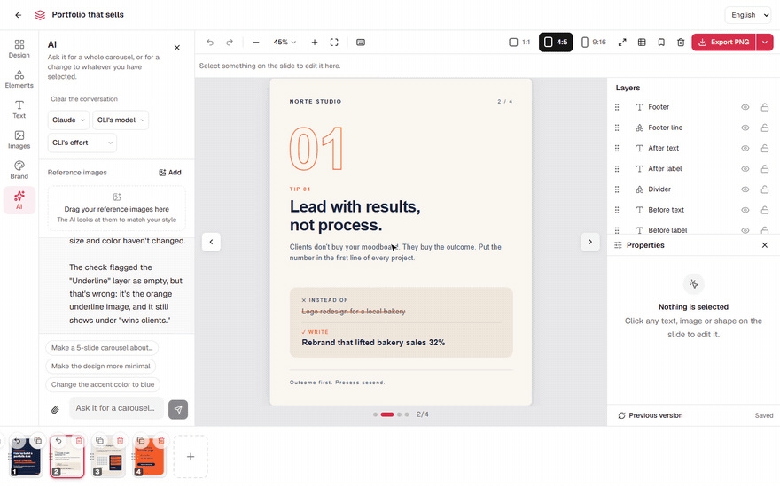
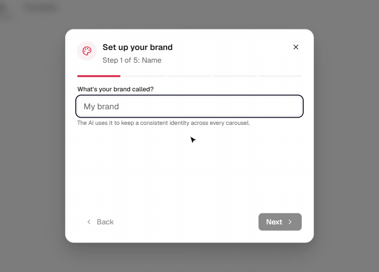
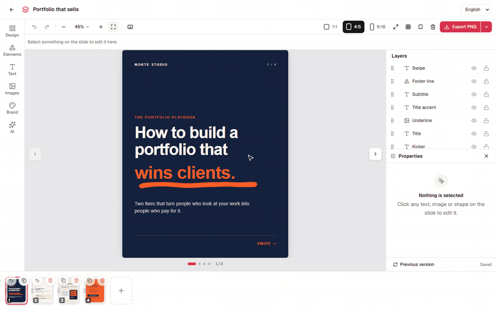

# Slides Lab

> Instagram carousels from a conversation. Describe the carousel, the AI agent you already use builds it slide by slide, and you finish it in a real canvas editor. Everything runs on your machine.

Slides Lab is a local web app for designing Instagram carousels with an AI agent. You ask in the chat; the agent (Claude Code or Codex) writes each slide as HTML and CSS, renders it, looks at the render and fixes what doesn't fit. Then you adjust anything by hand and export at Instagram's exact sizes. No account, no database and no API key: the agent runs on the plan your CLI is already logged into.

[](media/slides-lab-agent.gif)

What that one message produced, exported at 1080×1350:


## Features

- **A carousel from one message:** the agent plans the deck, writes the slides one by one and you watch them land in the filmstrip. Before moving on it renders each slide, looks at the image and reads the layout warnings (cut-off text, elements off the canvas, empty boxes), so what it hands you is already checked. It also writes the caption and the hashtags, ready to copy.

- **Ask about what you selected:** select a text, an image or a shape and ask for a change. The agent gets that element as context and edits only that. Every slide keeps its last versions, so you can go back.

  [](media/slides-lab-select.gif)

- **A real canvas editor:** select, move with snapping guides and a position readout, resize, rotate. The toolbar follows the selection (font, size, weight, color, alignment, effects, opacity), the Properties panel edits content and exact values, and the Layers panel names, hides, locks, groups and reorders every element. Undo, redo and keyboard shortcuts for all of it.

  [](media/slides-lab-canvas.gif)

- **Elements and images:** shapes, lines and arrows, a searchable icon library, your uploads and a gallery. Tap to insert centered, then place and resize.

  [](media/slides-lab-elements.gif)

- **Image generation built in, through Codex:** describe an image in the Images panel and Codex's native image generation draws it, transparent background included. It lands in the gallery, ready to drop on the slide. No API key and no extra service: it runs on your ChatGPT plan through the Codex CLI, whichever engine drives the chat. The agent also generates images on its own when a slide calls for one, like the underline on the cover above; [the policy](docs/imagegen-policy.md) that decides when is a Markdown file you can edit.

  [](media/slides-lab-imagegen.gif)

- **Your brand, every time:** name, five colors, heading and body fonts, logo and style words. The first run walks you through it and the agent reads it on every turn. Add reference images of carousels you like and it follows their style. Save any carousel as a template.

  [](media/slides-lab-brand.gif)

- **Every Instagram format, exported exactly:** 1:1, 4:5 and 9:16, an overlay of the areas Instagram covers, and a fullscreen preview. Export the whole carousel or one slide as PNG, JPG, transparent PNG or PDF; several slides download as a ZIP. The export renders the same HTML you edit, so what you see is what you post.

  [](media/slides-lab-export.gif)

## Install

### With Claude Code (recommended)

```bash
git clone https://github.com/maurild14/slides-lab.git
cd slides-lab
claude
```

Then type `/start` in the Claude Code prompt. It installs the dependencies, creates your local data, starts the server and opens the browser. `/stop` stops it, `/doctor` checks your setup and `/reset` wipes your carousels and starts over (it asks first).

### Manually

```bash
git clone https://github.com/maurild14/slides-lab.git
cd slides-lab
npm run setup   # installs dependencies, creates data/, finds your agent CLI
npm run dev     # http://localhost:3000
```

The first install downloads Chromium for the export (about 300 MB), so it takes a minute or two.

## Requirements

- Node.js 22.18 or newer (`.nvmrc` pins 22).
- An agent CLI, installed and logged in: [Claude Code](https://docs.anthropic.com/en/docs/claude-code) or the [Codex CLI](https://developers.openai.com/codex/cli). Without one, the editor and the export still work; the chat doesn't.
- Windows, macOS or Linux. On Linux, Chromium may need the usual system libraries (`libnss3`, `libatk1.0-0` and friends).

## How it works

The chat panel starts your agent CLI as a subprocess (`claude -p` or `codex exec`) with a system prompt that holds your brand and the current carousel. The agent creates and edits slides by calling the app's own local API with `curl`, then reads back a render of each slide to check its work. Slides are stored as HTML in JSON files under `data/`; the editor shows them in sandboxed iframes and the export screenshots the same HTML with headless Chromium.

| Engine | Runs as | Images |
| --- | --- | --- |
| Claude | `claude -p` with only `curl`, `WebFetch` and file access limited to uploads and a private temp folder | through the Codex CLI, when it is installed |
| Codex | `codex exec` in its `workspace-write` sandbox | its built-in image generation |

You pick the engine, the model and the reasoning effort in the chat panel. Each engine keeps its own conversation.

More in [docs/architecture.md](docs/architecture.md) and [docs/agent-engines.md](docs/agent-engines.md).

## Configuration

Everything is optional. `npm run setup` writes `.env.local`; [.env.example](.env.example) lists the keys.

| Key | Default | Meaning |
| --- | --- | --- |
| `CLAUDE_CLI_PATH` | found on your `PATH` | Path to `claude`, if setup can't find it |
| `CODEX_CLI_PATH` | found on your `PATH` | Path to `codex`, if setup can't find it |
| `CHAT_MAX_BUDGET_USD` | `5.00` | Claude stops a single turn when its estimated cost reaches this |

Restart the server after changing it.

## Costs

Slides Lab is free; the agent isn't. Every chat turn is billed to the account your CLI is logged into: your Claude plan or API key, or your ChatGPT plan for Codex (images included). A full carousel from scratch is around 250k tokens. The chat panel shows how much of your plan's current window you have left. Codex has no per-turn cap.

## Privacy and security

- Your carousels, brand and uploads are files on your disk. Slides Lab has no server of its own and no telemetry.
- What the agent sees goes to its provider (Anthropic or OpenAI) under your account: your messages, your brand, the HTML of the carousel and the images it reads.
- Slides load their fonts from Google Fonts, and the agent can browse the web when it researches a topic.
- The app listens on `127.0.0.1` only and has no login. It rejects requests from other sites and other hostnames, so a web page can't drive it from your browser. Don't expose it to a network.
- The agent runs with a narrow allowlist, and slide HTML never runs scripts, in the editor or in the export.

The threat model and the risks that remain are in [SECURITY.md](SECURITY.md). To report a vulnerability, use the repository's private vulnerability reporting.

## Troubleshooting

- **"Claude CLI not found":** install Claude Code and log in, or set `CLAUDE_CLI_PATH` in `.env.local`. `npm run doctor` shows what it found.
- **Port 3000 is busy:** `/stop`, or `/start 3001`.
- **`403 Host not allowed`:** open the app at `localhost:<port>` or `127.0.0.1:<port>`, not a LAN IP or a custom hostname.
- **The chat stops with a budget error:** the turn reached `CHAT_MAX_BUDGET_USD`. Raise it and restart.
- **The chat stream dies mid-build:** something wrote a file inside the project and the dev server reloaded. See [docs/workflows.md](docs/workflows.md#troubleshooting).

## Contributing

See [CONTRIBUTING.md](CONTRIBUTING.md). The engineering docs live in [docs/](docs/README.md), and [AGENTS.md](AGENTS.md) is the entry point for AI coding agents.

## License

[MIT](LICENSE)
